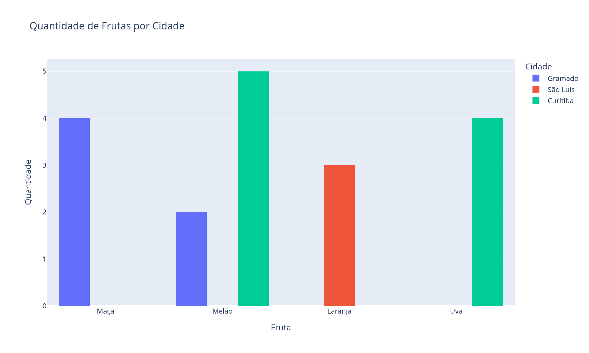

# Dashboard Fruits


## Sobre o Projeto

Projeto de análise de dados feito para praticar a criação de um DataFrame e sua visualização em um dashboard web.

O projeto usa dados fictícios de quantidade de frutas por cidade. Os dados são organizados em uma tabela com **Pandas**, transformados em um gráfico de barras com **Plotly** e exibidos em uma página web criada com **Dash**.

O projeto foi desenvolvido com finalidade educacional e de portfólio. O código é didático: cada passo vem comentado, para que quem está começando consiga acompanhar.

## Objetivos

- Criar um DataFrame a partir de um dicionário Python;
- Comparar a quantidade de cada fruta entre as cidades;
- Gerar um gráfico de barras agrupadas com Plotly Express;
- Exportar o gráfico como imagem (PNG);
- Publicar o gráfico em um dashboard web com Dash;
- Praticar visualização de dados com Python.

## Dados

O projeto usa um dataset fictício, guardado em `data/raw/fruits.csv`, com três colunas:

- **Fruits**: nome da fruta (Maçã, Laranja, Melão e Uva);
- **Amount**: quantidade;
- **City**: cidade (Gramado, São Luís e Curitiba).

Ao todo são **6 registros**, com **4 frutas** e **3 cidades**.

| Fruits  | Amount | City     |
|---------|-------:|----------|
| Maçã    | 4      | Gramado  |
| Laranja | 1      | São Luís |
| Melão   | 2      | Gramado  |
| Laranja | 2      | São Luís |
| Uva     | 4      | Curitiba |
| Melão   | 5      | Curitiba |

## Análise

Foram analisados indicadores relacionados a:

- Quantidade total de frutas;
- Quantidade por fruta;
- Quantidade por cidade.

A soma de todas as quantidades é **18 unidades**.

O **Melão** é a fruta com maior quantidade, com **7 unidades** (2 em Gramado e 5 em Curitiba).

**Curitiba** tem a maior quantidade, com **9 unidades**, e **São Luís** a menor, com **3 unidades**.

## Demonstração

### Quantidade de Frutas por Cidade



*Gráfico de barras agrupadas gerado com Plotly: cada cor representa uma cidade.*

## Metodologia

O projeto foi desenvolvido em quatro etapas:

1. **Dados**: leitura e validação do CSV bruto com Pandas (`src/datafruit/data.py`);
2. **Exploração**: qualidade dos dados e respostas às perguntas da análise (`notebooks/01_exploracao_dados.ipynb`);
3. **Visualização**: gráfico de barras agrupadas com Plotly e exportação em PNG com Kaleido (`notebooks/02_visualizacao.ipynb`);
4. **Dashboard**: página web com Dash publicada em um servidor local (`src/datafruit/dashboard.py`).

## Como Executar

1. Crie o ambiente virtual e instale as dependências (Python 3.14):

   ```bash
   python -m venv .venv
   source .venv/bin/activate
   pip install -r requirements.txt
   ```

2. Copie as configurações de exemplo:

   ```bash
   cp .env.example .env
   ```

3. Rode o pipeline completo (gera `data/processed/` e o gráfico em `reports/figures/`):

   ```bash
   python -m datafruit.pipeline
   ```

4. Suba o dashboard e abra [http://127.0.0.1:8050](http://127.0.0.1:8050):

   ```bash
   python -m datafruit.dashboard
   ```

5. (Opcional) Explore os notebooks e rode os testes:

   ```bash
   jupyter lab notebooks/
   pytest
   ```

Para desligar o servidor, use `Ctrl+C` no terminal (ou o botão Stop do PyCharm).

## Tecnologias e Ferramentas

- **Python**
- **Pandas**
- **Plotly**
- **Dash**
- **Kaleido**
- **Jupyter**
- **pytest**
- **PyCharm**

## Estrutura do Projeto

```text
DataFruit/
│
├── data/
│   ├── raw/                   # dados originais (nunca editados à mão)
│   │   └── fruits.csv
│   └── processed/             # dados tratados, gerados pelo pipeline
│
├── notebooks/                 # análise passo a passo
│   ├── 01_exploracao_dados.ipynb
│   └── 02_visualizacao.ipynb
│
├── reports/
│   └── figures/
│       └── fruits.png         # gráfico exportado
│
├── src/
│   └── datafruit/             # código reutilizável (pacote Python)
│       ├── config.py          # caminhos e variáveis do .env
│       ├── data.py            # leitura, validação e resumos
│       ├── visualization.py   # gráficos com Plotly
│       ├── pipeline.py        # roda tudo de ponta a ponta
│       └── dashboard.py       # app web com Dash
│
├── tests/                     # testes automatizados (pytest)
├── .env.example               # modelo das configurações
├── pyproject.toml             # metadados do pacote
├── requirements.txt           # dependências
└── README.md
```

## Objetivo de Aprendizagem

Este projeto foi desenvolvido para praticar e consolidar conhecimentos em:

- Criação e manipulação de DataFrames com Pandas;
- Visualização de dados com Plotly;
- Desenvolvimento de dashboards web com Dash;
- Exportação de gráficos como imagem;
- Organização de projetos de dados (notebooks + pacote Python);
- Testes automatizados com pytest;
- Organização e documentação de projetos.

## Autor

**Cristian Matias de Souza**, Analista de Dados
